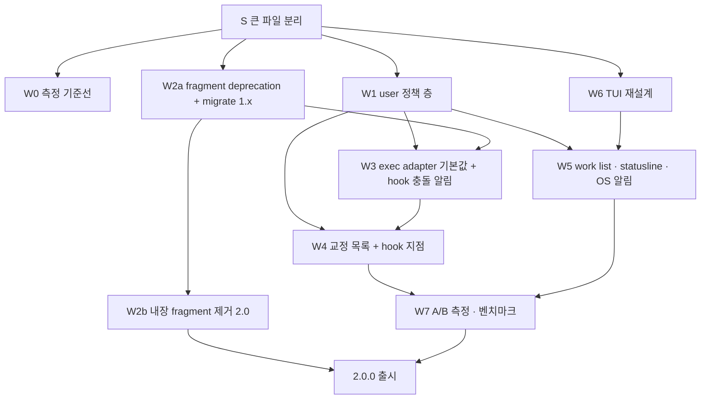

# Plan: 가벼운 비서형 anamnesis (2.0)

- 작성일: 2026-11-20
- 상태: 초안(구현 전). 독립 리뷰 3회 반영(1차 High 6·Medium 9·Low 6, 2차 Medium 3·Low 5, 3차 Medium 1·Low 3).
- 근거: 실제 사용 기록 분석(비공개). 이 문서에는 분석 결과의 수치만 옮긴다. 프로젝트와 조직 이름은 넣지 않는다.

## 1. 목표

anamnesis를 harness가 아닌 **가벼운 보조 도구**로 만든다.

1. 문맥 주입을 최소로 한다. 모델 token을 쓰는 동작은 실패를 직접 막는 경우에만 둔다.
2. 사용자가 묻지 않아도 상태가 바뀌면 먼저 알린다. 알림은 모델 token을 쓰지 않는 경로(statusline, OS 알림, 예약 보고)로 보낸다.
3. 반복된 교정은 글로 쓴 규칙이 아니라 결정적 검사로 막는다.
4. 여러 프로젝트의 지침과 정책을 한 곳에서 관리한다.
5. 사람이 읽는 CLI 출력을 다시 설계한다.

### 1.1 근거 (비공개 사용 기록 분석)

| 관찰 | 값 |
|---|---|
| 사용자 입력 중 진행 상황 질문 | 10~21% (세션별) |
| 교정 사건 23건의 1위 원인 | 요구 해석 오류 7건 |
| 교정이 서브에이전트에게 전달되지 않은 사건 | 4건 |
| 금지 용어 교정 뒤 재발 | lead 0회, teammate 57회 |
| 매 세션 읽는 지침 크기 | 약 72KB (일부는 전역 파일과 managed region의 중복) |
| Work 정책 | 기존 설치는 `reconciliation`·`review`·`delegation`이 모두 `off` (하위 호환 기본값) |

## 2. 사용자 결정 사항

1. 내장 stack fragment를 제거한다. 이유: 처음에는 다 갖춘 상태를 원했지만 유지보수가 되지 않는다.
2. `--allow-exec-adapters`를 기본값으로 한다. 대신 hook 충돌이 생기면 사용자에게 알린다.
3. Work 정책을 기본으로 켠다.
4. 교정 주입·검사 지점은 모두 둔다(9절).
5. 나머지는 분석 보고서의 권고를 따른다.
6. CLI 사람용 출력(TUI)을 다시 설계한다.
7. 개발 지침을 따른다. 파일 하나는 2,000줄을 넘지 않는다.

## 3. 개발 규칙

이 계획의 모든 작업에 적용한다. 새로 쓰거나 바꾸는 코드에 적용한다.

1. **파일 크기:** 파일 하나는 2,000줄 이하로 둔다. 줄 수를 맞추려고 억지로 자르지 않는다. 역할과 책임(SOLID)으로 나눈다. 시험(`cli/src/core/file_size_limit.test.ts`)이 막는다. 검사 범위는 4.1절에 둔다.
2. **SOLID:** 변경 이유가 같은 책임을 한 모듈에 묶는다. 실제 확장 경계에만 확장점을 둔다. 소비자별로 작은 interface를 둔다. 핵심 로직은 파일 시스템·프로세스·터미널 같은 외부 의존에서 분리한다.
3. **문자열 union 금지:** 새 코드에 `"a" | "b"` 같은 문자열 리터럴 union, 글자 값 enum, 글자 템플릿 타입을 직접 쓰지 않는다. 값 집합은 그 개념을 소유한 곳 한 곳에 열거 값 객체(`as const` 객체와 해석 함수)로 둔다. 바깥 글자(JSON, YAML, hook 입력)는 경계에서 한 번만 해석한다.
   - 예외 1: zod schema에서 파생한 타입(`z.infer`)과 그 schema의 `z.enum`. 이유: 경계 해석 그 자체다.
   - 예외 2: 공개 API의 기존 타입(예: `ToolName`). 이유: 바꾸면 공개 API가 깨진다.
   - 기존 코드는 새 값 집합을 더할 때만 열거 값 객체로 옮긴다. 파일 전체를 다시 쓰지 않는다.
4. **주석:** 새 주석을 쓰지 않는다. 이유가 꼭 필요하면 `// comment: <이유>` 한 줄로 쓴다. JSDoc과 파일 머리 설명도 새로 쓰지 않는다.
5. **시험:** 새 core 변경에는 같은 폴더에 `*.test.ts`를 둔다. CHANGELOG에 기록한다(AGENTS.md Conventions).
6. **화면 규칙:** 터미널 출력의 칩과 같은 줄의 글은 같은 열·같은 기준선에 맞춘다. vitest와 확대 캡처로 확인한다(11.5절).
7. **시험 격리:** 사용자 home의 파일(`~/.anamnesis/`)을 읽는 코드는 환경변수로 위치를 바꿀 수 있어야 한다. 시험은 임시 폴더를 쓴다.

## 4. 작업 흐름 전체



- S(큰 파일 분리)를 가장 먼저 한다. 이유: 거의 모든 작업이 `cli/src/index.ts`를 바꾼다. 먼저 나누어야 작업끼리 충돌하지 않는다.
- 내장 fragment 제거는 두 단계로 한다. 1.x에서 deprecation과 `migrate fragments`를 먼저 출시한다. 2.0에서 지운다. 이유: 3-way 비교 기준(`.versions/`)이 남아 있는 동안 이전을 끝낼 수 있다.
- 2.0.0은 major 버전이다. 이유: 내장 fragment 제거와 exec adapter 기본값 변경은 기존 동작을 바꾼다.

### 4.1 S 큰 파일 분리

동작을 바꾸지 않는 refactor다. 시험 결과가 분리 전과 같아야 한다.

| 파일 | 줄 수 | 나누는 기준 |
|---|---:|---|
| `cli/src/index.ts` | 5,473 | 인자 해석, 명령 연결(dispatch), 명령별 사람용 보고(`report*`)를 나눈다. 보고 함수는 `cli/src/report/<명령>.ts`로 옮긴다 |
| `cli/src/commands/benchmark_work_parallel_agent.ts` | 3,465 | 시나리오 정의, 실행, 채점, 보고로 나눈다 |
| `cli/src/commands/work.ts` | 2,519 | 명령별(mutation, status, hook, delegation)로 나눈다 |
| `cli/src/core/work_contract.ts` | 2,135 | schema, 검증, 계약 계산으로 나눈다 |
| `cli/src/core/work_contract.test.ts` | 2,165 | 위 분리에 맞춰 시험 파일을 나눈다 |
| `docs/ROADMAP.md` | 2,547 | 출시된 버전 기록을 `docs/roadmap/` 아래 버전별 파일로 옮긴다 |
| `docs/DOGFOOD.md` | 2,533 | 오래된 기록을 `docs/dogfood/` 아래 날짜별 파일로 옮긴다 |
| `CHANGELOG.md` | 2,045 | 오래된 1.x 기록을 `docs/changelog/` 아래로 옮긴다 |

- 검사 대상: `cli/src/**/*.ts`, `scripts/**/*.{mjs,js,ts}`, `base/**`와 `fragments/**`의 손으로 쓴 파일, 저장소의 손으로 쓴 `*.md`.
- 제외: `cli/dist/`, `node_modules/`, `.anamnesis/backups/`, `_workspace/`, lock 파일, 시험 fixture의 생성 결과, `docs/benchmark-evidence/**`의 생성된 JSON(예: `work-agent-ab.json` 4,071줄). 이유: 측정 원자료이고 손으로 쓰지 않는다.
- 완료 기준: 2,000줄 시험이 통과한다. `npm test`, `npm run typecheck`, `npm run lint`, `npm run build`가 분리 전과 같이 통과한다. `cli/src/api.ts`의 export가 같다. 문서 안의 링크가 옮긴 파일을 가리킨다.

## 5. W0 측정 기준선

| 항목 | 내용 |
|---|---|
| 목적 | 나머지 작업의 효과를 확인한다 |
| 지표 | 상태 질문 비율, 같은 교정의 반복 비율, 말한 사람별 규칙 재발 횟수(lead / teammate / 도구 출력), 강한 불만 표현 비율 |
| 입력 | 로컬 Claude Code export 텍스트 |
| 출력 | `anamnesis benchmark user-pain`(가칭) JSON과 요약 |
| ⚠️ 개인정보 | 원문을 저장하지 않는다. 개수와 규칙 id만 저장한다 |
| 완료 기준 | 비공개 분석의 수치를 같은 방법으로 다시 만들 수 있다. 한국어 오탐(예: "판매")을 허용 목록으로 처리한다. fixture는 가상 대화로 만든다 |

## 6. W1 user 정책 층

### 6.1 파일 위치

| 종류 | 위치 | 덮어쓰기 | 이유 |
|---|---|---|---|
| 사용자가 쓰는 설정 | `~/.anamnesis/` (`policy.yaml`, `config.yaml`, `corrections.yaml`, `fragments/`) | `ANAMNESIS_HOME` | 사용자가 직접 읽고 고친다. dotfiles로 관리할 수 있다 |
| 기계 상태 | 지금 그대로 `ANAMNESIS_STATE_HOME`(macOS 기본 `~/Library/Application Support/anamnesis/`) 아래 `projects.json` | `ANAMNESIS_STATE_HOME` | 사람이 고치지 않는 상태다. 기존 registry를 옮기지 않는다 |

### 6.2 변경

| 항목 | 내용 |
|---|---|
| 문제 | 정책 층 목록에 `user`가 있다(`cli/src/core/work_policy.ts:177`). 채우는 코드가 없다. `resolveCommandPolicy`(`cli/src/commands/work.ts:2049`)는 프로젝트 `Agentfile`(v2)만 읽는다 |
| 변경 | `resolveCommandPolicy`가 `~/.anamnesis/policy.yaml`을 `user` 층으로 읽는다. 내용은 Agentfile `settings.work_policy`와 같은 schema다 |
| 생성 | 이미 제안된 `anamnesis context policy configure --scope user`(WORK-UNIT-DESIGN.md "User-configurable review policy")를 구현한다. 이 명령이 `policy.yaml`을 만든다. `--preset recommended`가 6.3절 기본값을 쓴다. `recommended`는 기존 정책별 preset 값이 아니라 세 정책을 한 번에 정하는 묶음 이름이다. WORK-UNIT-DESIGN.md의 제안 명령 절도 함께 갱신한다 |
| 프로젝트 층과의 관계 | 지금 `init`은 Agentfile에 `work_policy`(adaptive, advisory, auto)를 쓴다(`cli/src/commands/init.ts:209-217`). 정책 병합(`mergeNormalized`, `work_policy.ts:776-790`)은 정책 영역을 통째로 고른다. 그래서 프로젝트 값이 있으면 user 값이 하나도 적용되지 않는다. 대응: (1) `policy.yaml`이 있으면 `init`은 프로젝트 `work_policy`를 쓰지 않는다. 이 동작은 의도한 것이다. 결과: 같은 저장소를 쓰는 다른 기계는 제품 기본값(`off`)으로 해석한다. 프로젝트에 정책을 남기려면 `init --project-policy`를 쓴다. (2) `anamnesis migrate policy`가 예전 `init` 기본값과 의미가 같은 프로젝트 블록만 지운다. 비교 방법: 버전별 `init` 기본값 목록을 두고, 정규화한 정책(`normalizeWorkPolicyConfig` 결과)의 hash를 비교한다. 사용자가 고친 블록은 남기고 보고한다. 적용 범위는 현재 프로젝트이고, `--all`은 registry의 모든 프로젝트다. `--dry-run`과 backup은 7.2절 4항과 같다. (3) `doctor`가 user 층을 가리는 프로젝트 블록을 finding으로 보인다 |
| 처음 실행 | `init`과 `upgrade`는 `policy.yaml`이 없으면 만들지 묻지 않고 안내만 한다. 만들기는 위 명령으로 한다 |
| 우선순위 | 지금 설계를 그대로 쓴다: 현재 지시 > Work별 > task harness > 프로젝트 > user > 제품 |
| 기록 | contract snapshot의 `source_refs`에 home 경로를 쓰지 않는다. `user:policy.yaml`과 내용 hash만 쓴다. 이유: ledger는 공유될 수 있다 |
| 열린 Work | 이미 열린 Work는 고정된 snapshot을 유지한다. 다음 contract revision에서 새 정책을 적용한다. 정책이 바뀌면 `status`가 drift로 보고한다 |
| v1 Agentfile | user 층은 `Agentfile` 버전과 관계없이 적용한다 |
| home을 프로젝트로 init | 프로젝트 root가 home이면 `init`은 거부한다. 이유: `~/.anamnesis/`가 사용자 설정 폴더와 프로젝트 상태 폴더를 함께 맡게 된다 |
| 완료 기준 | `policy.yaml`만 있고 프로젝트 `Agentfile`에 정책이 없을 때 user 값이 적용된다. `status`와 `doctor`가 값의 출처를 보인다. 시험은 `ANAMNESIS_HOME`으로 격리한다 |

### 6.3 기본값 (`--preset recommended`)

지금 schema(`cli/src/core/work_policy.ts:43-160`)에 맞춘 값이다.

```yaml
reconciliation:
  preset: custom
  triggers: [work_resume, compaction_resume, contract_revision, before_work_close]
review:
  preset: advisory   # planning·completion gate 모두 advisory
delegation:
  parallelism: auto
  max_agents: 4
```

- "모두 켠다"의 범위: 세 정책을 모두 켠다. reconciliation은 interval과 `meaningful_milestone` trigger를 끈다. 이유: 이 둘이 가장 자주 주입한다.
- review는 PR 리뷰 규칙을 대신하지 않는다. 이유: Work 하나에 PR이 여러 개일 수 있다. PR이 없는 Work도 있다. 그래서 PR 리뷰 결과를 completion gate의 증거로 인정한다. 리뷰는 한 번만 실행한다.
- CPU·메모리 상한(`resource_ceiling_percent`)은 `delegationSchema`가 `.strict()`라서 지금 넣을 수 없다. 새 필드로 schema를 바꾸는 일은 W1 범위에 넣는다. 값은 사용자 설정으로 둔다.

## 7. W2 fragment 구조 변경

### 7.1 범위

- 제거 대상: `fragments/` 아래 14개(django, docker-compose, fastapi, go, k8s, nestjs, nextjs, nuxt, prisma, python-uv, rails, remix, rust, sveltekit).
- 함께 다룰 것:
  1. `rulebook.md`의 자동 감지 규칙
  2. fragment에 묶인 introspector(`cli/src/introspectors/{nextjs,prisma,k8s}.ts`)
  3. fragment가 설치한 실행 hook(예: `k8s`의 `yaml-lint.sh`, `prisma`의 `prisma-validate.sh`)과 `settings.json` 등록
  4. fragment가 소유한 ontology 파일(`.anamnesis/ontology/<id>.yaml`, fragment.yaml `owns`)
  5. 3-way 비교 기준인 `.versions/`(`cli/src/commands/update.ts:199`, `cli/src/commands/render_plan.ts:146`)
  6. fragment id를 쓰는 cli 시험(30개 이상)과 `benchmark_session_context.ts`의 fixture(706, 776, 786행)
  7. `package.json` `files`의 `fragments`
- `base`는 남긴다. 이유: `base`는 stack 설명이 아니다. hook, slash command, skill, handoff, Work를 담은 제품 본체다.
- 과거 `docs/benchmark-evidence/`는 바꾸지 않는다. 이유: 그때의 측정 기록이다.

### 7.2 W2a (1.x): deprecation과 이전

1. `status`, `doctor`, `apply`, `update`가 내장 stack fragment를 "2.0에서 제거 예정"으로 보고한다.
2. `anamnesis migrate fragments`를 만든다. fragment마다 하나를 고른다.
   - a. **사용자 소유로 바꾸기(기본):** managed region의 anchor만 지우고 글은 남긴다. 그 fragment가 설치한 hook 파일과 `settings.json` 등록은 그대로 두고 manifest의 소유 기록에서 뺀다. ontology 파일도 그대로 두고 소유 기록에서 뺀다. Agentfile `fragments[]`에서 그 id를 지운다.
   - b. **사용자 fragment로 내보내기:** fragment 전체(`.versions/` 포함)를 `~/.anamnesis/fragments/<id>/`로 복사한다. 그 뒤로는 사용자 fragment로 관리한다.
3. 고르지 않으면 a를 적용한다. 이유: 사용자 글과 hook을 잃지 않는다.
4. `--dry-run`으로 바뀔 파일을 먼저 보인다. 바꾸기 전에 backup을 만든다(지금 안전 모델과 같다).
5. `projects plan`이 등록된 모든 프로젝트의 이전 대상을 한 번에 보인다.

### 7.3 W2b (2.0): 제거

1. 7.1절 목록을 지운다. introspector도 지운다.
2. 사라진 fragment id가 `Agentfile`에 남아 있으면 `apply`는 오류가 아니라 "더 이상 제공하지 않음, `migrate fragments`를 실행하라"로 보고하고 그 fragment만 건너뛴다.
3. `docs/API.md`와 `docs/MIGRATION-2.0.md`에 `Fragment` 의미 변화(`fragment_source` 추가, 내장 목록 축소)를 쓴다.

### 7.4 사용자 fragment root

| 항목 | 내용 |
|---|---|
| 위치 | `~/.anamnesis/fragments/<id>/` (`ANAMNESIS_HOME`으로 바꿀 수 있다) |
| 읽는 순서 | 내장 root(`base`) → 사용자 root |
| id 충돌 | 사용자 fragment는 `base`와 같은 id를 쓸 수 없다. 같은 id면 오류를 낸다. 이유: 덮어쓰기를 허용하면 npm 업그레이드의 변경이 조용히 사라진다 |
| 기록 | manifest에 `fragment_source`(`builtin` 또는 `user`)와 `fragment_content_hash`를 더한다. 경로는 기록하지 않는다. `doctor`가 drift를 보고한다 |
| 배포 | 기존 project registry와 `anamnesis upgrade --apply`로 등록된 모든 프로젝트에 적용한다 |
| 범위 원칙 | 모든 프로젝트에 같은 규칙은 `~/.claude/CLAUDE.md`·`~/.codex/AGENTS.md`에 둔다. 일부 프로젝트에만 맞는 규칙만 사용자 fragment에 둔다. 같은 규칙을 두 곳에 두지 않는다 |
| 코드 위치 | `resolveLibraryRoot`(`cli/src/index.ts:515`, 15곳에서 호출), `fragmentDirOf`(`cli/src/core/fragments.ts:164`), `cli/src/core/manifest.ts` |

## 8. W3 exec adapter 기본값과 hook 충돌 알림

### 8.1 기본값 변경

- `init`, `apply`, `update`, `upgrade`는 기본으로 실행 가능 adapter(hook, command, skill)를 쓴다.
- 끄는 방법: `--no-exec-adapters` 또는 `~/.anamnesis/config.yaml`의 `exec_adapters: false`.
- **registry와의 관계:** registry는 프로젝트마다 `allow_exec_adapters`를 필수 boolean으로 기록한다(`cli/src/core/project_registry.ts:28, 350`). 지금은 플래그 없이 등록하면 `false`를 저장한다. 그래서 사용자가 고른 `false`와 기본값으로 저장된 `false`를 구별할 수 없다.
  1. 동의 출처 필드 `exec_consent_source`(explicit, default, legacy)를 더한다.
  2. 기존 기록은 모두 `legacy`로 읽고 값을 유지한다. 이유: `upgrade --apply` 한 번으로 등록된 모든 프로젝트에 hook이 설치되는 것을 막는다.
  3. 새 기본값은 새로 등록하는 프로젝트에만 적용한다(`default`).
  4. `upgrade`와 `projects plan`은 `legacy`이면서 `false`인 프로젝트 수를 보이고, 바꾸는 명령 `anamnesis projects set --exec-adapters on [--all]`을 안내한다.
  5. `upgrade_plan.ts:243`과 `upgrade_apply_choice.ts:130-207`을 이 규칙에 맞춘다.
  6. registry 형식 변경: `registeredProjectSchema`와 `projectRegistrySchema`는 `.strict()`이고 `version`은 고정 값이다(`project_registry.ts:21-38`). 그래서 `REGISTRY_VERSION`을 올린다. 이전 버전 registry를 읽으면 `exec_consent_source: legacy`로 채워 새 버전으로 저장한다. 이전 CLI가 새 버전 registry를 만나면 쓰지 않고 "anamnesis를 업그레이드하라"고 안내한다. 이 변경을 `MIGRATION-2.0.md`에 쓴다.
- ⚠️ 공급망 위험이 커진다. 이유: 사용자 fragment root를 dotfiles로 pull하면 남이 쓴 hook이 바로 설치될 수 있다. 대응:
  1. 실행 파일을 새로 쓰거나 바꿀 때 파일 목록과 hash를 출력한다.
  2. manifest에 설치한 실행 파일의 hash를 기록한다.
  3. 사용자 fragment 안의 실행 파일은 `anamnesis fragments trust <id>`로 처음 한 번 승인해야 설치한다. 승인은 내용 hash에 묶는다. 내용이 바뀌면 다시 승인한다. 내장 `base`는 승인 없이 설치한다.
     - 승인 기록은 기계 상태(`ANAMNESIS_STATE_HOME`)에 둔다. `ANAMNESIS_HOME`(`~/.anamnesis/`) 안에 있는 승인 기록은 무시한다. 이유: `~/.anamnesis/`는 dotfiles로 pull될 수 있다. 남의 dotfiles와 함께 승인 기록이 들어오면 hash 승인이 우회된다.
  4. `fragments trust`는 **설치 동의**다. Codex hook의 **런타임 신뢰**(`anamnesis hooks codex trust --apply`, DESIGN.md 7.2절)와 다르다. 두 이름을 섞지 않는다.
- 문서 갱신(W3 범위): `docs/DESIGN.md` 7.1절의 "명시 플래그 없이는 실행 파일을 건드리지 않는다" 불변식, `AGENTS.md`의 운영 원칙, `cli/src/core/cli_guide.ts`, `init_next_steps.ts`의 안내 글.
- 서명: DESIGN.md 7.3절이 미룬 외부 fragment 서명·pinning은 이번에도 하지 않는다. 사용자 fragment는 로컬 파일이고 hash 승인으로 대신한다. 원격 fragment 배포는 이 계획의 범위가 아니다.

### 8.2 hook 충돌 감지

| 충돌 종류 | 예 | 처리 |
|---|---|---|
| 파일 충돌 | `.claude/hooks/<name>`을 사용자가 고쳤다 | 덮어쓰지 않는다(지금 동작). 알린다 |
| 같은 이벤트의 이중 주입 | 다른 plugin도 SessionStart에서 문맥을 넣는다 | 알린다. 주입하는 hook 목록을 보인다 |
| 차단 경쟁 | 다른 PreToolUse hook이 같은 도구를 deny한다 | 알린다. 같은 matcher의 hook 목록을 보인다 |
| 같은 명령 중복 등록 | 같은 hook 명령이 두 번 등록되어 있다 | 알린다. 하나로 합치는 명령을 제안한다 |

- 조사 범위: 프로젝트 `.claude/settings.json`, `.claude/settings.local.json`, `~/.claude/settings.json`, 켜진 plugin의 hook, `.codex/hooks.json`.
- 알리는 곳: `init`·`apply`·`update`·`upgrade` 출력의 경고 섹션, `doctor`의 finding, statusline의 경고 칩.
- 자동으로 고치지 않는다. 이유: 다른 도구의 hook은 사용자의 설정이다.

## 9. W4 교정 목록과 hook 지점

### 9.1 교정 목록

- 파일: `~/.anamnesis/corrections.yaml`(전역)과 프로젝트 `.anamnesis/corrections.yaml`(선택).
- 형식:

```yaml
- id: banned-term-example
  kind: banned_term          # banned_term | ui_rule | process_rule
  pattern: "금지할 말"
  allow: ["허용할 복합어"]
  scope: [assistant, teammate, subagent]
  enforcement: warn          # warn | block
  reminder: "금지할 말 대신 '버전'을 쓴다."
  source: "사용자 교정 2026-11-19"
```

- `reminder`는 주입에 쓴다. `pattern`은 검사에 쓴다. 결정적으로 검사할 수 없는 규칙(`process_rule`)은 주입만 한다.
- `kind`, `scope`, `enforcement` 값 집합은 열거 값 객체 한 곳에 둔다(3절 3항).

### 9.2 지점 (Claude Code)

Claude Code 공식 hooks 문서(https://code.claude.com/docs/en/hooks.md, 2026-11-20 확인)의 "SubagentStart", "SessionStart", "Stop input", "SubagentStop input", "PreToolUse decision control" 절에서 확인한 기능만 쓴다.

| 지점 | 동작 | token(추정) |
|---|---|---|
| 1. `SubagentStart` | `reminder` 목록을 `additionalContext`로 넣는다 | 서브에이전트 1개마다 300~600 |
| 2. SessionStart matcher `compact` | `reminder` 목록만 다시 넣는다. reconciliation `compaction_resume` 출력과 하나로 합친다 | compaction 1회마다 약 500 |
| 3. Stop / SubagentStop | `last_assistant_message`를 검사한다. 주입하지 않는다 | 통과하면 0 |
| 4. PreToolUse matcher `SendMessage` | 보낼 글을 검사한다. 위반이면 deny하고 이유를 돌려준다 | 통과하면 0 |

- 4번을 더한 이유: Stop과 SubagentStop은 teammate끼리 보내는 메시지를 보지 못한다. 재발 57회가 이 경로였다.
- PreToolUse `updatedInput`은 쓰지 않는다. 이유: 입력 전체를 교체한다. Agent 도구 `prompt`에 적용되는지 문서에 없다.
- ⚠️ `SendMessage` matcher는 문서에 이 도구 이름이 없다. 구현 전에 stdin을 기록하는 시험 hook으로 확인한다. 동작하지 않으면 SubagentStop 검사만 쓰고 한계를 문서에 남긴다.
- ⚠️ Stop 검사의 한계: 사용자는 그 응답을 이미 본 뒤다. Stop 검사는 다음 응답을 고치게 할 뿐이다. 그래서 1번·2번 주입이 1차 방어이고 3번·4번 검사가 2차 방어다.

### 9.3 Codex와 Cursor

| 지점 | Codex | Cursor |
|---|---|---|
| 1. 서브에이전트 시작 주입 | 지원하지 않음. delegated child의 bounded contract(WORK-UNIT-DESIGN.md "Automatic delegation")에 `reminder`를 넣는다 | 지원하지 않음 |
| 2. compaction 뒤 주입 | native SessionStart wrapper가 있으면 같은 방법. 없으면 지원하지 않음 | 지원하지 않음 |
| 3. 응답 끝 검사 | native Stop wrapper가 있으면 같은 방법 | 지원하지 않음 |
| 4. 메시지 검사 | 지원하지 않음 | 지원하지 않음 |

- 이 표를 `cli/src/adapters/parity.ts`의 parity matrix와 `docs/ADAPTER-PARITY.md`에 반영한다.

### 9.4 안전장치

1. 루프 방지: `stop_hook_active`가 `true`면 막지 않는다. 한 턴에 block은 1회만 한다. 그 뒤로는 경고만 내고 위반을 evidence로 남긴다.
2. 오탐: 새 규칙은 `enforcement: warn`으로 시작한다. 1주 동안 오탐률을 잰 뒤 `block`으로 바꾼다.
3. 개인정보: 검사기는 글을 로컬에서만 읽는다. 저장하지 않는다. 규칙 id와 위반 수만 기록한다.
4. ANSI: hook 하위 명령은 색을 강제로 끈다. 이유: hook 환경에 `FORCE_COLOR`가 상속되면 모델 문맥에 ANSI가 섞인다.

## 10. W5 work list, statusline, OS 알림

| 항목 | 내용 |
|---|---|
| `anamnesis work list` | 열린 Work와 닫힌 Work를 한 화면에 보인다. 지금은 목록 명령이 없다 |
| `anamnesis work board --statusline` | 한 줄: 막힘 수, 사용자 결정 대기 수, 실행 중 agent 수, 쉬는 agent 수, 마지막 증거 시각. 모델 token을 쓰지 않는다 |
| statusline 성능 | statusline은 화면을 갱신할 때마다 프로세스를 새로 실행한다. 실행 시간 상한은 100ms다. ledger 요약은 cache 파일(ledger 크기·수정 시각이 같으면 재사용)로 읽는다 |
| OS 알림 | 상태가 바뀔 때만 보낸다: 막힘, 결정 필요, 쉬는 agent, Work 완료. hook JSON의 `terminalSequence`(OSC 9/99/777)를 쓴다(hooks 문서 "Emit terminal notifications"). 대화형 세션에서만 동작한다 |
| 아침 보고서 | `anamnesis work report --since <시각>`: 완료, 미결, 결정 대기, 실패한 검증. 예약 실행은 사용자 환경(cron, Claude Code 예약 작업)에 맡긴다 |
| 결정 event | 결정에 `authority`(user 또는 agent)를 기록한다. lead가 사용자 대신 정한 결정을 구분해서 보인다 |

## 11. W6 TUI 재설계

### 11.1 확인한 사실

- 공통 렌더러 `cli/src/core/tui.ts`(375줄)가 이미 있다. 판정 줄, 섹션, 정렬 행, 전각 폭 계산, NO_COLOR 처리를 한다.
- 보고 함수는 이 부품을 일부만 쓴다. `cli/src/index.ts`에 직접 출력이 437곳 있다. `createTui()` 호출은 16곳이다.
- 문제점:
  1. 한 블록에 정렬 행과 `key: value` 줄이 섞인다(`work status`, `doctor`, `init`).
  2. 행을 하나씩 렌더링해서 열 정렬이 끊긴다. 같은 명령이 두 번 나온다(`init --dry-run`).
  3. 상태 칩이 없다. 상태가 `[pending]` 같은 글로만 나온다.
  4. 판정이 두 단계뿐이다. 오래된 evidence 하나도 경고가 된다.
  5. 값 전체에 색을 칠한다. 숫자와 단위가 같은 무게로 보인다.
  6. East Asian Width가 애매(A)한 기호(`●`, `—`, `…`, `│`)를 쓴다. 한국어 터미널 설정에 따라 정렬이 깨진다.
  7. 터미널 폭이 0으로 보고되면 폭이 40열로 고정된다(`tui.ts:92-97`).

### 11.2 결정

- 의존성 0을 유지하고 `tui.ts`를 키운다. 이유:
  1. 이 패키지는 사용자 저장소의 hook 경로에서 실행된다. 의존성이 늘면 공급망 위험이 커진다.
  2. 문제는 부품 부족이 아니라 부품을 쓰지 않는 것이다.
  3. 지금 hook과 `--json` 출력에 ANSI가 없다. 이 장점을 지킨다.
- Ink는 쓰지 않는다. 이유: 직접 의존성이 22개이고 react가 필요하다. 전체 화면 렌더러라서 hook과 파이프 출력에 맞지 않는다.
- 대화형 선택(`upgrade choose` 등)은 마지막 단계에서 `@clack/prompts`(직접 의존성 4개) 지연 로드를 따로 판단한다.

### 11.3 디자인 규칙

참고: clig.dev, GitHub CLI(Primer, 접근성 개편), Charm Lip Gloss, @clack/prompts, uv, Biome reporter.

1. 색은 16색 ANSI 의미 토큰만 쓴다: `ok` green, `warn` yellow, `err` red, `info` cyan, `dim`, `cmd` magenta, `strong` bold. 값 전체를 칠하지 않는다. 숫자만 칠하고 단위와 설명은 `dim`으로 둔다.
2. 색은 의미를 보강할 뿐이다. 기호와 글자를 항상 함께 쓴다.
3. 상태 기호는 폭이 확정된 것만 쓴다: `✓`(U+2713), `✗`(U+2717), `!`, `i`, `◌`(U+25CC), `◉`(U+25C9). ASCII 대체 기호를 둔다.
4. 판정은 네 단계로 나눈다: Ready, Notice, Attention, Failed. 오래된 evidence는 Notice다.
5. 제목 줄은 한 줄로 쓴다: `anamnesis <명령>  <범위>`.
6. 한 블록에는 한 문법만 쓴다. 열 정렬은 블록 전체로 계산한다.
7. 상태 칩은 대괄호 포함 6칸 고정 폭이다: `[ OK ]`, `[WARN]`, `[FAIL]`, `[INFO]`, `[TODO]`, `[WORK]`. 칩 글자는 4칸 안에서 가운데에 둔다. 칩 뒤의 글은 모든 행에서 같은 열에서 시작한다. 색이 없어도 칩 글자가 남아서 정렬이 유지된다.
8. 폭이 바뀌는 글(한국어 제목, 경로)은 마지막 열에 둔다.
9. 다음 행동은 마지막에 둔다. 같은 명령은 한 번만 쓴다.
10. 진행 표시는 TTY에서만 쓴다. `ANAMNESIS_NO_PROGRESS`로 끈다. 비TTY에서는 평문만 쓴다. `NO_COLOR`가 `FORCE_COLOR`보다 앞선다.

### 11.4 목업 (가상 값)

```text
anamnesis status  example-app

i Notice  everything is in sync; 1 note

  managed      12/12  clean      1 fragment
  continuity    6/6   checks
  hooks         5/5   runnable   0 conflicts

Notes  1
  [INFO] evidence     latest record is 30 days old

Next
  anamnesis doctor             check install integrity
```

```text
anamnesis work  example-app  2 open, 5 closed

Open  2
  [WORK] add-login-form        40%   2/5   로그인 화면 추가
  [TODO] fix-docs-links         -     -    (new)
```

### 11.5 시험

1. 칩 정렬 vitest: 모든 행에서 ANSI를 지운 뒤 칩 다음 첫 글자의 표시 열이 같다. 48열, 80열, 120열과 한국어 행으로 확인한다.
2. hook 경로 ANSI 0 시험: `FORCE_COLOR=1`에서도 hook 하위 명령의 출력에 `\x1b[`가 없다.
3. 애매 폭 기호 금지 시험: 렌더러 출력에 East Asian Width A 기호가 없다.
4. 확대 캡처: 실제 터미널(macOS Terminal, iTerm2, Ghostty)에서 칩과 같은 줄의 글이 같은 기준선과 같은 열에 있는지 캡처로 확인한다.

## 12. W7 측정과 벤치마크

1. W0 지표를 2주 동안 잰다. 1주는 statusline만 쓰고, 1주는 statusline과 reconciliation 브리핑을 함께 쓴다.
2. 끄는 기준: 검증된 requirement당 token이 10% 넘게 늘거나, 상태 질문 비율이 줄지 않으면 브리핑을 끈다.
3. 교정 지점(W4)은 on/off A/B로 재발 횟수와 token을 잰다.
4. 결과를 README 벤치마크와 같은 형식(paired runs, 평균·중앙값, 한계 명시)으로 `docs/benchmark-evidence/`에 남긴다.

## 13. 출시

- 1.x: S, W0, W1, W2a, W6, W3(기본값 변경 제외)
- 2.0.0: W2b, W3 기본값 변경, W4, W5, W7(측정 결과를 출시 전에 기록한다)
- 이전 안내 `docs/MIGRATION-2.0.md`:
  1. 내장 stack fragment 제거와 `migrate fragments` 사용법
  2. exec adapter 기본값 변경, registry 기존 값 유지 규칙, 끄는 방법
  3. user 정책 층, `ANAMNESIS_HOME`, 기본값, `migrate policy`
  4. registry 형식 변경(`exec_consent_source`, `REGISTRY_VERSION`)
  5. 교정 목록 파일 형식
  6. `docs/API.md`의 `Fragment` 의미 변화
- 출시는 `npm run release:prepare/publish/verify` 순서만 쓴다(AGENTS.md "Release operations").

## 14. 위험

| 위험 | 대응 |
|---|---|
| exec adapter 기본값으로 원하지 않는 hook이 설치된다 | registry 기존 `false` 유지, 실행 파일 목록·hash 출력, 사용자 fragment 실행 파일은 hash 승인 필요(8.1) |
| 교정 검사 오탐으로 응답이 자꾸 막힌다 | warn으로 시작, 턴당 block 1회, 허용 목록(9.4) |
| reconciliation 브리핑이 token을 늘린다 | trigger를 좁힘, A/B로 재고 기준을 넘으면 끔(12절) |
| fragment 제거로 기존 프로젝트의 managed region·hook·ontology가 고아가 된다 | 1.x에서 이전 먼저, 기본은 사용자 소유로 바꾸기(7.2) |
| 같은 규칙이 전역 파일과 fragment에 중복된다 | `context audit-instructions`가 중복을 보고한다. 중복 규칙은 한 곳으로 옮긴다 |
| home 경로가 공유 ledger에 남는다 | source ref는 `user:policy.yaml`과 hash만 쓴다(6.2) |
| 시험이 실제 사용자 home을 읽는다 | `ANAMNESIS_HOME` 격리를 시험 완료 기준에 넣는다(3절 7항) |
| `SendMessage` hook이 동작하지 않는다 | 구현 전 시험 hook으로 확인한다. 안 되면 SubagentStop 검사만 쓴다 |

## 15. 완료 기준

1. `anamnesis context policy configure --scope user --preset recommended`와 `anamnesis migrate policy` 한 번씩으로 등록된 모든 프로젝트의 Work 정책이 켜진다. 사용자가 고친 프로젝트 정책은 남고 `doctor`가 보고한다.
2. 1.x에서 내장 stack fragment를 쓰는 프로젝트가 `migrate fragments`로 글·hook·ontology를 잃지 않고 이전된다. 2.0에서 내장 stack fragment가 없다.
3. `init`이 기본으로 hook을 설치한다. 기존 registry 기록(`legacy`)의 값은 바뀌지 않는다. 충돌이 있으면 경고 섹션과 `doctor`에 보인다.
4. 교정 목록의 금지 용어가 teammate 메시지, 서브에이전트 보고, lead 응답에서 검사된다.
5. statusline 한 줄로 막힘, 결정 대기, 쉬는 agent를 볼 수 있다. 상태가 바뀌면 OS 알림이 온다.
6. `status`, `doctor`, `work status`, `work list`, `init` 출력이 11.3절 규칙을 지키고 11.5절 시험을 통과한다.
7. 2,000줄을 넘는 검사 대상 파일이 없다.
8. W0 지표로 변경 전후를 비교한 결과가 `docs/benchmark-evidence/`에 있다.
